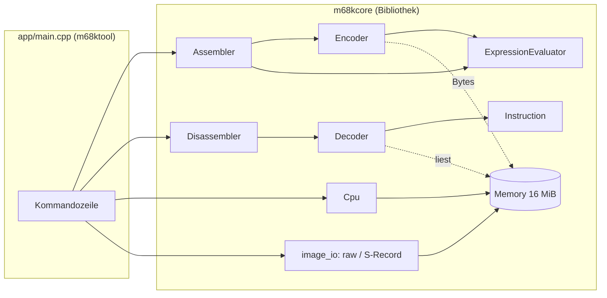

# Architektur

> Die Struktur entspricht dem [Z80-Projekt](https://github.com/PhotonPower/Z80); Komponenten, die
> noch nicht existieren, sind mit *(geplant)* markiert.

## Überblick

Die Bibliothek `m68kcore` hat **keine** Konsolenausgabe und keinen globalen Zustand; alle Klassen
sind unabhängige Instanzen. `app/main.cpp` ist die einzige Stelle mit Ein-/Ausgabe auf
Stdin/Stdout und mit Dateinamen. Monitor und Agenten-Schnittstelle sind weitere Frontends
derselben Bibliothek.

## Komponenten

| Header (`include/m68k/`)            | Aufgabe                                                      | Stand   |
|-------------------------------------|--------------------------------------------------------------|---------|
| `types.hpp`, `version.hpp`          | `Byte`/`Word`/`Long`, Adressraum, `Size`, Version            | fertig  |
| `format.hpp`                        | Zahlenformatierung (`$1F`, `0x1F`, `1FH`)                    | fertig  |
| `memory.hpp`                        | `Memory`: dünn besetzter 16-MiB-Adressraum, Big-Endian       | fertig  |
| `instruction.hpp`                   | `Instruction`: Adresse, Bytes, Mnemonic, Operanden, `FlowKind`, Ziel | fertig  |
| `decoder.hpp`                       | `decode(memory, address, options)` → ein `Instruction`       | fertig  |
| `expression.hpp`                    | Ausdrucksauswerter                                           | fertig  |
| `encoder.hpp`                       | `encodeInstruction(request, value)` → Bytes; Operanden-Parser | fertig  |
| `assembler.hpp`                     | Zeilenparser, Symboltabelle, Mehrpass, `AssemblyResult`      | fertig  |
| `disassembler.hpp`                  | Ablaufanalyse, Querverweise, Kommentare, Ausgabe (`render`)  | fertig  |
| `image_io.hpp`                      | Dateien lesen/schreiben, S-Record                            | fertig  |
| `hunk.hpp`                          | Amiga-Hunk-Lader (Relokation, Symbole)                       | fertig  |
| `cpu.hpp`                           | `Registers`, `Cpu` (Ausführung, Ausnahmen, Breakpoints)      | geplant |
| `snapshot.hpp`, `json.hpp`, `session.hpp` | Zustand speichern/laden, Agenten-Protokoll             | geplant |
| `monitor.hpp`                       | `Monitor`: Zeilenschnittstelle                               | geplant |

## Die Befehlstabelle

Dekoder und Encoder teilen sich **eine** Tabelle (`src/forms.cpp`, intern): 164 *Formen* mit Name,
Opcode-Maske und -Wert, Größenfeld, Operandenarten (Register in Bits 11–9 oder 2–0, `<ea>`, Unmittelbares,
Sprung, Registerliste …) und den erlaubten Adressierungsarten je `<ea>`. Familien wie `Bcc`, `Scc`,
`DBcc` und die Schiebebefehle werden in Schleifen erzeugt.

- Der **Dekoder** nimmt die erste Form, deren Maske passt; ist dann ein Operand unerlaubt (z. B. `An` als
  Ziel von `ADD Dn,<ea>`), ist das Wort unerlaubt. Spezifische Formen stehen deshalb vor allgemeinen
  (`ADDX` vor `ADD`, `EXT` vor `MOVEM`, `MOVEA` vor `MOVE`, …).
- Der **Encoder** sucht Formen gleichen Namens, prüft Operandenarten und Wertebereiche und baut Opcode
  und Erweiterungswörter. Weil beide dieselbe Tabelle benutzen, kann es keine Form geben, die nur eine der
  beiden Seiten kennt; Tabellenfehler fallen im Roundtrip- und im `objdump`-Vergleich auf.
- Nicht-kanonische Erweiterungswörter (Byte-Unmittelbares mit oberem Byte ≠ 0, Indexwörter mit gesetzten
  Skalierungsbits des 68020) lehnt der Dekoder ab. So bleibt `assemble(disassemble(x)) == x` exakt.

## Assembler

Der Assembler läuft **mehrfach** über den Quelltext:

1. Durchläufe, bis sich Symboltabelle **und** die gewählten Größen nicht mehr ändern (höchstens 40).
   Für jede Zeile merkt er sich eine *Stufe* (0 = kleinste Form); unbestimmte Sprünge und absolute
   Adressen starten klein und wachsen nur. Weil Größen nie schrumpfen, konvergiert das Verfahren.
2. Der letzte Durchlauf liefert Bytes, Listing und – erst jetzt – Fehlermeldungen (so gibt es keine
   Scheinfehler aus Zwischenzuständen).

Verschiebungen werden modulo 2²⁴ berechnet, weil der Programmzähler des 68000 bei 16 MiB umläuft; der
Dekoder rechnet Sprungziele genauso.

## Disassembler

`Disassembler` hält pro Byte des Bereichs einen Zustand (Daten / Befehlsanfang / Befehlsrest). `analyzeFlow()`
folgt Wegen von den Einstiegspunkten: ein Weg endet bei `RTS`/`RTE`/`RTR`/`ILLEGAL`, bei unbedingten Sprüngen,
bei ungültigen Wörtern, bei Code, der schon analysiert ist (oder überlappen würde), und am Bereichsende.
Ziele von `BSR`/`JSR`/`Bcc`/`DBcc`/`BRA`/`JMP` werden neue Wege und Labels; Datenzugriffe (absolut oder PC-relativ)
werden nur Labels. `render()` setzt Labels über einen `Symbolizer` in die Operanden ein; Labels, die in der
Mitte einer Zeile liegen, werden im Quelltext-Modus als `EQU` mit ihrem Wert definiert. Ein Label ersetzt
nie einen Operanden, dessen Wert es nicht exakt trifft (`abs.L` mit oberem Byte, vorzeichenerweitertes `.W`).

## Unterschiede zum Z80, die den Entwurf bestimmen

- **Befehlslänge hängt vom Operandenwert ab.** Beim Z80 ist die Länge eines Befehls durch Mnemonic
  und Operandenart festgelegt; beim 68000 nicht: `BRA` hat eine 8-Bit- oder 16-Bit-Verschiebung,
  absolute Adressen sind `.W` oder `.L`, `MOVEQ`/`ADDQ` haben Wertebereiche. Der Assembler muss
  deshalb **Befehlslängen über mehrere Durchläufe bestimmen** (Verschiebungsgröße wählen, bis sich
  nichts mehr ändert) – die Konvergenzannahme des Z80-Assemblers („Längen hängen nie vom Wert eines
  Symbols ab“) gilt hier nicht.
- **Dekoder:** Die Operanden stecken in Bitfeldern (Modus/Register), Erweiterungswörter folgen je
  nach Adressierungsart. Der Dekoder zerlegt wie beim Z80 den Opcode nach Schema statt nach einer
  65536-Einträge-Tabelle; unbekannte Muster ergeben `valid == false`, damit die
  Roundtrip-Eigenschaft `assemble(disassemble(x)) == x` erhalten bleibt.
- **Big-Endian, gerade Adressen.** `Memory` liefert rohe Bytes; Adressfehler gehören in die CPU.
- **Ausnahmen und Privilegien.** Der Emulator braucht Supervisor-/Benutzermodus, zwei Stapelzeiger
  und eine Ausnahmebehandlung mit Stapelrahmen – beim Z80 gab es nur Interrupts.

## Erweiterungspunkte

- `decode()` ist zustandslos und kann für „disassembliere ab hier, n Befehle“ direkt verwendet werden.
- `Symbolizer` lässt den Dekoder Zieladressen als Namen ausgeben.
- `Memory` lässt sich um Speicher-Hooks (ROM, speicherabgebildete E/A) erweitern, ohne den Kern zu ändern.
