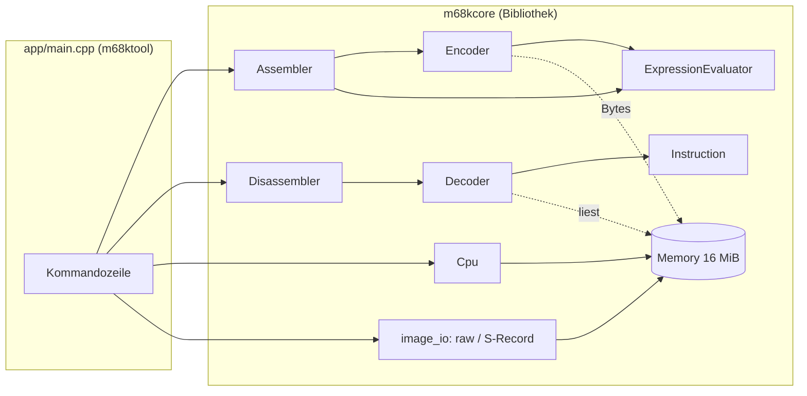

# Architektur

> Die Struktur entspricht dem [Z80-Projekt](https://github.com/PhotonPower/Z80); Komponenten, die
> noch nicht existieren, sind mit *(geplant)* markiert.

## Überblick

Die Bibliothek `m68kcore` hat **keine** Konsolenausgabe und keinen globalen Zustand; alle Klassen
sind unabhängige Instanzen. `app/main.cpp` ist die einzige Stelle mit Ein-/Ausgabe auf
Stdin/Stdout und mit Dateinamen. Monitor und Agenten-Schnittstelle sind weitere Frontends
derselben Bibliothek.

## Komponenten

| Header (`include/m68k/`)            | Aufgabe                                                      | Stand   |
|-------------------------------------|--------------------------------------------------------------|---------|
| `types.hpp`, `version.hpp`          | `Byte`/`Word`/`Long`, Adressraum, `Size`, Version            | fertig  |
| `format.hpp`                        | Zahlenformatierung (`$1F`, `0x1F`, `1FH`)                    | fertig  |
| `memory.hpp`                        | `Memory`: dünn besetzter 16-MiB-Adressraum, Big-Endian       | fertig  |
| `instruction.hpp`                   | `Instruction`: Adresse, Wörter, Mnemonic, Operanden, Flussart | geplant |
| `decoder.hpp`                       | `decode(memory, address)` → ein `Instruction`                | geplant |
| `expression.hpp`                    | Ausdrucksauswerter                                           | geplant |
| `encoder.hpp`, `assembler.hpp`      | Befehl → Wörter, Mehrpass-Assembler                          | geplant |
| `disassembler.hpp`                  | Ablaufanalyse, Querverweise, Kommentare, Ausgabe             | geplant |
| `cpu.hpp`                           | `Registers`, `Cpu` (Ausführung, Ausnahmen, Breakpoints)      | geplant |
| `snapshot.hpp`, `json.hpp`, `session.hpp` | Zustand speichern/laden, Agenten-Protokoll             | geplant |
| `monitor.hpp`                       | `Monitor`: Zeilenschnittstelle                               | geplant |
| `image_io.hpp`                      | Dateien lesen/schreiben, S-Record                            | geplant |

## Unterschiede zum Z80, die den Entwurf bestimmen

- **Befehlslänge hängt vom Operandenwert ab.** Beim Z80 ist die Länge eines Befehls durch Mnemonic
  und Operandenart festgelegt; beim 68000 nicht: `BRA` hat eine 8-Bit- oder 16-Bit-Verschiebung,
  absolute Adressen sind `.W` oder `.L`, `MOVEQ`/`ADDQ` haben Wertebereiche. Der Assembler muss
  deshalb **Befehlslängen über mehrere Durchläufe bestimmen** (Verschiebungsgröße wählen, bis sich
  nichts mehr ändert) – die Konvergenzannahme des Z80-Assemblers („Längen hängen nie vom Wert eines
  Symbols ab“) gilt hier nicht.
- **Dekoder:** Die Operanden stecken in Bitfeldern (Modus/Register), Erweiterungswörter folgen je
  nach Adressierungsart. Der Dekoder zerlegt wie beim Z80 den Opcode nach Schema statt nach einer
  65536-Einträge-Tabelle; unbekannte Muster ergeben `valid == false`, damit die
  Roundtrip-Eigenschaft `assemble(disassemble(x)) == x` erhalten bleibt.
- **Big-Endian, gerade Adressen.** `Memory` liefert rohe Bytes; Adressfehler gehören in die CPU.
- **Ausnahmen und Privilegien.** Der Emulator braucht Supervisor-/Benutzermodus, zwei Stapelzeiger
  und eine Ausnahmebehandlung mit Stapelrahmen – beim Z80 gab es nur Interrupts.
- **Zyklen.** Der 68000 erledigt Buszugriffe in Vielfachen von vier Takten; die Zeit pro Befehl
  hängt von Adressierungsart und Operandengröße ab ([emulator.md](emulator.md)).

## Erweiterungspunkte

- `decode()` ist zustandslos und kann für „disassembliere ab hier, n Befehle“ direkt verwendet werden.
- `Symbolizer` lässt den Dekoder Zieladressen als Namen ausgeben.
- `Memory` lässt sich um Speicher-Hooks (ROM, speicherabgebildete E/A) erweitern, ohne den Kern zu ändern.
